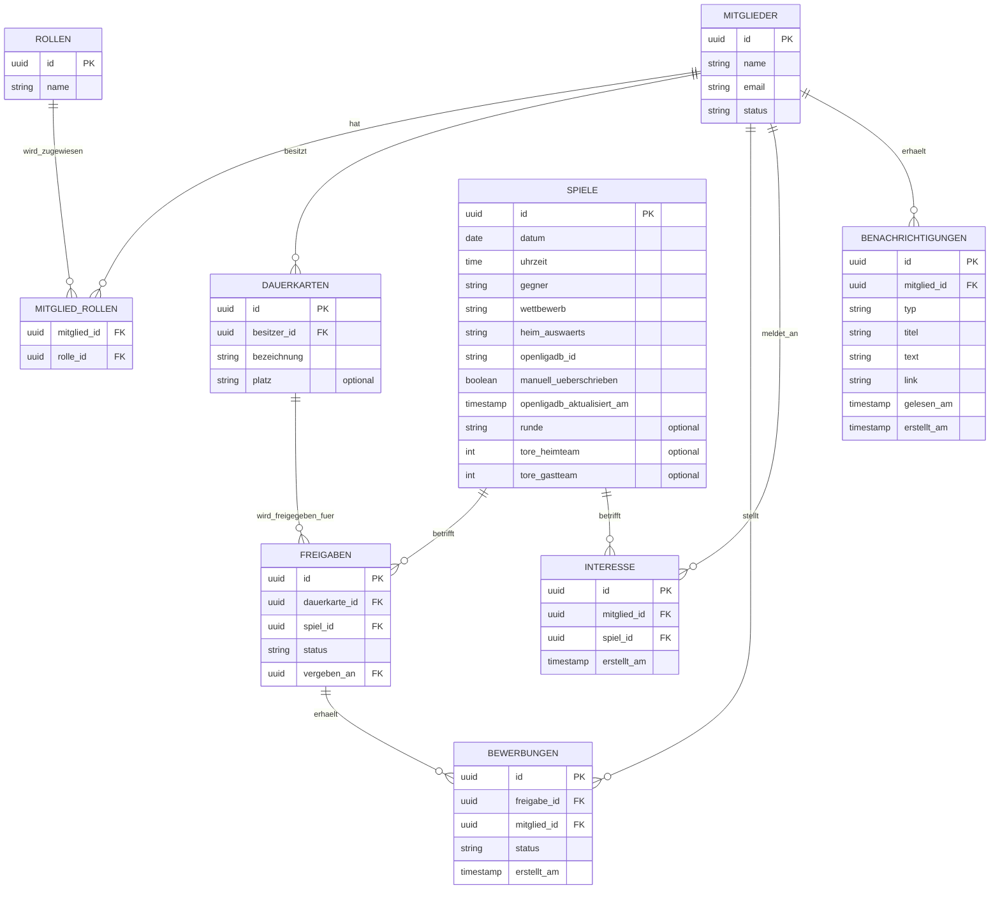

# Seefüchse-App – Projektdokumentation

> Verwaltungstool für Dauerkarten-Freigaben des SC Freiburg Fanclubs „die Seefüchse" – ersetzt die bisherige Excel-Verwaltung.

> Für KI-Coding-Assistenten (z. B. GitHub Copilot): ausführlicher Entwicklungskontext, Architekturentscheidungen, bekannte Workarounds und Coding-Konventionen liegen in [`.github/copilot-instructions.md`](.github/copilot-instructions.md). Dieses README bleibt der kompakte Überblick für Menschen.

## Inhalt

- [Über das Projekt](#über-das-projekt)
- [Kernfunktion](#kernfunktion)
- [Tech-Stack](#tech-stack)
- [Datenbankstruktur](#datenbankstruktur)
- [Offene und gesperrte Spiele](#offene-und-gesperrte-spiele)
- [Rollensystem](#rollensystem)
- [Seiten-Übersicht](#seiten-übersicht)
- [Implementierungsstand](#implementierungsstand)
- [Projektstruktur](#projektstruktur)
- [Spielplan-Synchronisation](#spielplan-synchronisation)
- [Setup / Lokale Entwicklung](#setup--lokale-entwicklung)
- [Deployment](#deployment)
- [Git-Konventionen](#git-konventionen)
- [Offene Punkte](#offene-punkte)

## Über das Projekt

Die Seefüchse sind ein Fanclub des SC Freiburg mit Sitz am Bodensee und rund 28 Mitgliedern. Der Club besitzt 12 Dauerkarten und 2 Fanclubkarten, die nicht bei jedem Spiel von allen Besitzern genutzt werden können. Bisher lief die Verwaltung freier Karten über Excel; die Seefüchse-App digitalisiert diesen Prozess vollständig, inklusive Spielplan, Kartenfreigabe und Bewerbung.

## Kernfunktion

Kann ein Dauerkarten-Besitzer ein Spiel nicht besuchen, gibt er seine Karte für dieses Spiel in der App frei. Alle Mitglieder sehen sofort, welche Karten für welches Spiel frei sind, und können sich darauf bewerben. Mitglieder können außerdem schon vor einer Freigabe **Interesse** an einem Spiel anmelden; Besitzer sehen diese Interessenten und können ihre Karte direkt an sie vergeben. Der Besitzer entscheidet manuell, wem er die Karte gibt – es gibt keine automatische Vergabe nach Reihenfolge oder Losverfahren. Benachrichtigungen laufen in-app (Glocke im Header), es ist kein E-Mail-Versand vorgesehen.

Ablauf in Kurzform: **Freigabe** durch DK-Besitzer → **Bewerbung** durch Mitglieder (oder vorher **Interesse**) → **Entscheidung** durch DK-Besitzer → **Vergabe**.

## Tech-Stack

- Frontend: SvelteKit 5 (mit Runes: `$props`, `$state`, `$effect`, `$derived`)
- Datenbank: PostgreSQL über Supabase, Zugriff via Drizzle ORM
- Hosting: Netlify (`adapter-netlify`, plus eine Netlify Scheduled Function für den regelmäßigen Spielplan-Sync)
- Icons: `@lucide/svelte` (Nachfolger von `lucide-svelte`, welches deprecated wurde)
- Karten: Leaflet.js (als Abhängigkeit installiert, im Code noch nicht verwendet)
- Styling: Custom CSS, mobile-first ab 375px, Desktop begrenzt auf max. 720px
- Schriften: Inter (UI-Text) und JetBrains Mono (Zahlen/Daten)
- Installierbar als Web-App (Manifest + Service Worker ohne Caching)
- Entwicklung: VS Code, GitHub

Supabase wurde gegenüber Neon und MongoDB bevorzugt, weil Auth und Row Level Security bereits eingebaut sind und kein separates Auth-System nötig ist.

## Datenbankstruktur

Das ER-Diagramm unter `DB-stucture/seefuechse_er_diagramm_V2.html` zeigt den Planungsstand (Kerntabellen). Maßgeblich ist `src/lib/server/db/schema.ts`. Die Kerntabellen:



Die `id` von `mitglieder` ist zugleich Foreign Key auf `auth.users.id` (Supabase verwaltet diese Tabelle selbst, daher gibt es bei `mitglieder` kein eigenes Passwort-Feld). Die `status`-Felder sind als Postgres-Enums implementiert, nicht als freier Text:

- `mitglieder.status`: `ausstehend` / `aktiv` / `abgelehnt`
- `freigaben.status`: `offen` / `vergeben` / `zurueckgezogen`
- `bewerbungen.status`: `angefragt` / `angenommen` / `abgelehnt`
- `benachrichtigungen.typ`: `neue_anfrage` / `anfrage_angenommen` / `anfrage_abgelehnt` / `karte_freigegeben` / `neues_interesse`

Alle Tabellen in Kürze:

- **mitglieder** – Stammdaten der Mitglieder (per FK an `auth.users`); `status` steuert den Freischaltungs-Flow
- **rollen** – verfügbare Rollen (Admin, Vorstand, Mitglied)
- **mitglied_rollen** – Verknüpfungstabelle Mitglied ↔ Rolle (many-to-many)
- **dauerkarten** – die 12 Dauerkarten + 2 Fanclubkarten, jeweils einem Besitzer zugeordnet; `bezeichnung` unterscheidet mehrere Karten (z. B. „DK 1", „Fanclubkarte 1"); alle Karten liegen im selben Block, daher kein Block/Reihe, `platz` ist optional
- **spiele** – Spielplan mit Datum und Anstoßzeit (`uhrzeit`, null = unbekannt); `openligadb_id` verknüpft das Spiel mit OpenLigaDB, `manuell_ueberschrieben` schützt Handkorrekturen vor dem Sync; `runde` (z. B. „10. Spieltag", „Achtelfinale") und das Endergebnis `tore_heimteam`/`tore_gastteam` (Stadion-Reihenfolge, beide null = noch kein Ergebnis) kommen aus dem Sync
- **freigaben** – verknüpft eine Dauerkarte mit einem Spiel, sobald sie freigegeben wird
- **bewerbungen** – Bewerbungen von Mitgliedern auf eine Freigabe (eine pro Mitglied und Freigabe)
- **interesse** – Interessensbekundung eines Mitglieds für ein Spiel, unabhängig von einer Freigabe (eine pro Mitglied und Spiel)
- **benachrichtigungen** – In-App-Benachrichtigungen je Mitglied (Glocke), `gelesen_am` null = ungelesen
- **push_abos** – Web-Push-Abos je Gerät/Browser (Endpoint und Schlüssel); Tabelle angelegt, im Code noch nicht verwendet
- **benachrichtigung_einstellungen** – Push an/aus je Mitglied und Benachrichtigungstyp; Tabelle angelegt, im Code noch nicht verwendet
- **sync_laeufe** – Protokoll der Spielplan-Syncs (Zeitpunkt, Quelle `cron`/`manuell`, Zähler, Hinweise), Einträge älter als 90 Tage werden automatisch gelöscht

Wichtig: Der „DK-Besitzer" ist keine eigene Rolle, sondern ergibt sich aus der Zuordnung in `dauerkarten`.

**Schema-Änderungen** werden manuell im Supabase SQL Editor angewendet, `schema.ts` wird von Hand nachgezogen. Kein `drizzle-kit push` ausführen: Der UNIQUE-Index auf `spiele.openligadb_id` existiert nur in der Datenbank und würde entfernt.

## Offene und gesperrte Spiele

Ein Spiel ist **offen**, solange `datum >= heute` (Europe/Berlin) und noch kein Endergebnis eingetragen ist (`tore_heimteam IS NULL`); ein Spiel von heute bleibt also bis zum Ergebnis offen. Sonst ist es **gesperrt**: Freigeben, Interesse anmelden, Bewerben und Vergeben (auch nachträglich) lehnen die Server-Actions mit „Dieses Spiel hat bereits stattgefunden.“ (409) ab, ohne Datenänderung und ohne Benachrichtigung. **Zurückziehen** (Freigabe, Interesse, Bewerbung) bleibt immer erlaubt, damit sich alte Einträge aufräumen lassen. Die Regel steht an einer Stelle: `src/lib/server/spielStatus.ts`. Die Detailseite zeigt bei gesperrten Spielen nur noch das Zurückziehen; `/karte`, `/anfragen` und das Dashboard (freie Karten, eigene offene Freigaben) listen nur noch offene Spiele. Abgelehnte Aktionen erscheinen als Fehlermeldung auf der Seite, nicht als Fehlerseite.

## Rollensystem

Drei Rollen: Admin, Vorstand, Mitglied. Sie sind many-to-many über `mitglied_rollen` verknüpft. Vorstand hat den gleichen Funktionsumfang wie Admin, mit einer Ausnahme: die Seite „Rollen verwalten" ist ausschließlich Admins vorbehalten.

Technisch wird das über `hatVerwaltungsRolle(userId)` bzw. `hatAdminRolle(userId)` in `src/lib/server/rollen.ts` geprüft, sowohl im `load()` einer Seite als auch nochmal in jeder einzelnen Server-Action (Defense-in-Depth – die Berechtigung wird nicht nur durch Verstecken von UI-Elementen erzwungen).

Rollen werden in der App unter `/verwaltung/rollen` zugewiesen. Die Seite setzt je Mitglied genau eine Rolle (bestehende Zuordnungen werden ersetzt).

## Seiten-Übersicht

Mockups dazu liegen unter `mockups/`.

- **Start** (`/`) – Dashboard mit Begrüßung, offenen Bewerbungen auf die eigene Karte (falls DK-Besitzer), den nächsten Spielen und allen aktuell club-weit freigegebenen Karten
- **Spielplan** (`/spielplan`) – alle Spiele der Saison, Tabs Kommende/Vergangene, Filter Liga/Pokal/Europa/Testspiele, zeigt freie Karten je Spiel und kennzeichnet vorläufige Anstoßzeiten; jede Spielkachel verlinkt zur Detailseite. Die Kachel zeigt links groß Spieltag bzw. Runde (z. B. „3 Spieltag", „Achtelfinale"; ohne Runde das Datum), daneben Datum und Uhrzeit, und bei beendeten Spielen rechts das Ergebnis in Stadion-Reihenfolge (Heim : Gast). „Vergangene" enthält Spiele vor heute (Europe/Berlin) oder mit Endergebnis, „Kommende" den Rest
- **Spieldetail** (`/spielplan/[id]`) – ein einzelnes Spiel: eigene Karte freigeben/zurückziehen, Bewerbungen entscheiden, an Interessenten direkt vergeben; Mitglieder können sich bewerben oder Interesse anmelden/zurückziehen. Bei gespielten Spielen zeigt die Seite den Hinweis „Dieses Spiel hat bereits stattgefunden.“ und nur noch das Zurückziehen eigener Einträge
- **Meine Dauerkarte** (`/karte`) – nur für DK-Besitzer: eigene Dauerkarte je kommendem Spiel freigeben/behalten, Bewerbungen einsehen und vergeben, Anzahl Interessenten je Spiel
- **Anfragen** (`/anfragen`) – für alle Mitglieder: eigene Interesse-Anmeldungen und Bewerbungen (zurückziehbar), für DK-Besitzer zusätzlich eigene offene Freigaben mit Bewerberliste
- **Benachrichtigungen** (`/benachrichtigungen`) – letzte 50 Benachrichtigungen, einzeln öffnen (markiert als gelesen) oder alle als gelesen markieren; erreichbar über die Glocke im Header mit Ungelesen-Zähler
- **Verwaltung** (`/verwaltung`) – für Admin/Vorstand: Freischaltung wartender Mitglieder, Spielplan-Sync (Button, letzter Lauf, Stichtag bestätigter Anstoßzeiten), Links zu Spielplan- und Rollenverwaltung; Dauerkarten-Übersicht mit Besitzer und dessen Status, Karten lassen sich dort (mit Bestätigung) entfernen. Angelegt werden Dauerkarten weiterhin nur über die Registrierung
- **Verwaltung → Spielplan** (`/verwaltung/spielplan`) – Spiele anlegen, bearbeiten, löschen; Erkennung ähnlicher Vereinsnamen
- **Verwaltung → Rollen verwalten** (`/verwaltung/rollen`) – nur Admin: Rolle zuweisen, Name/E-Mail ändern, Passwort-Mail senden
- **Login, Registrieren, Warten** (`/login`, `/registrieren`, `/warten`) – Auth-Seiten; `/warten` sehen Mitglieder mit Status `ausstehend`. Bei der Registrierung kann „Ich habe eine Dauerkarte" angehakt werden; dann wird automatisch eine Karte mit `besitzer_id = user.id` und `bezeichnung` „DK {Name}" angelegt, die der Vorstand in der Verwaltung kontrolliert
- **Passwort vergessen** (`/passwort-vergessen` → Mail → `/auth/callback?next=/passwort-neu` → `/passwort-neu`) – Reset-Link anfordern (neutrale Antwort), Callback tauscht `code` bzw. `token_hash` gegen eine Session, danach neues Passwort setzen
- **Cron-Endpoint** (`POST /api/cron/spielplan-sync`) – kein Seitenaufruf, wird von der Netlify Scheduled Function per Token aufgerufen

## Implementierungsstand

| Bereich | Status |
| --- | --- |
| Auth (Login, Registrierung, Freischaltung-Workflow, Passwort zurücksetzen) | ✅ fertig |
| Verwaltung → Mitglieder-Freischaltung | ✅ fertig |
| Start-Dashboard mit echten Daten | ✅ fertig |
| Spielplan (Liste, Tabs, Filter, „vorläufig"-Kennzeichnung) | ✅ fertig |
| Spieldetail-Seite (Freigabe, Bewerbung, Interesse, Vergabe) | ✅ fertig |
| Meine Dauerkarte (Freigeben/Vergeben) | ✅ fertig |
| Anfragen-Seite | ✅ fertig |
| Interesse anmelden/zurückziehen, Vergabe an Interessenten | ✅ fertig |
| NavBar („Anfragen" für alle, „Dauerkarte" nur für Besitzer, „Verwaltung" nur für Admin/Vorstand) | ✅ fertig |
| Verwaltung → Rollen verwalten | ✅ fertig |
| Verwaltung → Spielplan pflegen (anlegen, bearbeiten, löschen) | ✅ fertig |
| OpenLigaDB-Sync (04:00 UTC und stündlich 12–23 UTC per Netlify Scheduled Function + Button in `/verwaltung`, Protokoll in `sync_laeufe`) | ✅ fertig |
| In-App-Benachrichtigungen (Glocke, Liste, gelesen markieren) | ✅ fertig |
| Benachrichtigung bei Terminänderung durch den Sync | 📋 noch nicht begonnen |
| Web-Push | 🚧 nur vorbereitet (Tabellen, auskommentierter Service-Worker-Code) |
| Verwaltung → Dauerkarten anzeigen und entfernen | ✅ fertig |
| Dark/Light-Mode-Toggle | 📋 bewusst zurückgestellt |

Details zu offenen Punkten siehe unten, ausführlicher Kontext in `.github/copilot-instructions.md`.

## Projektstruktur

```
seefuechse/
├── .github/copilot-instructions.md  # Entwicklungskontext für KI-Assistenten
├── DB-stucture/              # ER-Diagramme (Planungsstand)
├── mockups/                  # Visuelle Mockups der Seiten
├── netlify/functions/        # Scheduled Function für den Spielplan-Sync (Cron)
├── testing/                  # Notizen zu manuellen Tests, Prozessgrafiken
├── tools/                    # Hilfsseite zum Erzeugen der App-Icons
├── src/
│   ├── routes/
│   │   ├── +page.svelte        # Start-Dashboard
│   │   ├── login/, registrieren/, logout/, warten/
│   │   ├── passwort-vergessen/, passwort-neu/
│   │   ├── auth/callback/      # Einstieg aus Auth-Mails (code / token_hash)
│   │   ├── spielplan/          # Liste
│   │   │   └── [id]/           # Spieldetail
│   │   ├── karte/              # Meine Dauerkarte (nur DK-Besitzer)
│   │   ├── anfragen/           # Interesse-Anmeldungen und Bewerbungen
│   │   ├── benachrichtigungen/ # Benachrichtigungsliste
│   │   ├── api/cron/spielplan-sync/  # Cron-Endpoint (Token-geschützt)
│   │   └── verwaltung/         # Freischaltung, Sync-Karte
│   │       ├── spielplan/      # Spiele pflegen
│   │       └── rollen/         # Rollen verwalten (nur Admin)
│   ├── lib/
│   │   ├── server/
│   │   │   ├── db/             # Drizzle-Schema, DB-Client, Fehlerhilfen
│   │   │   ├── freigaben.ts, bewerbungen.ts, interesse.ts  # Freigabe-/Bewerbungslogik
│   │   │   ├── dauerkarten.ts  # Dauerkarten-Übersicht und Entfernen (Verwaltung)
│   │   │   ├── benachrichtigungen.ts  # In-App-Benachrichtigungen
│   │   │   ├── spiele.ts, vereinsnamen.ts  # Spielpflege, Vereinsnamen-Abgleich
│   │   │   ├── spielplanSync.ts, spielplanTermine.ts  # OpenLigaDB-Sync, „vorläufig"
│   │   │   ├── rollen.ts, aktionen.ts, supabaseAdmin.ts
│   │   ├── components/         # Card, Header, MatchCard, NavBar, FreigabeZeile, FehlerHinweis
│   │   ├── zeit.ts, enhance.ts
│   │   └── supabase.ts
│   ├── hooks.server.ts         # Auth-Session + Routen-Schutz
│   ├── service-worker.ts       # ohne Caching, Push vorbereitet
│   ├── app.css                 # Design-Tokens
│   ├── app.html
│   └── app.d.ts
├── static/                   # Icons, Manifest
├── drizzle.config.ts
├── svelte.config.js
├── vite.config.js
├── package.json
└── .env.example
```

Nicht im Repo (per `.gitignore`): `build/` und `.netlify/` (Build-Artefakte), `.svelte-kit/`, `node_modules/`, `.env`.

## Spielplan-Synchronisation

Spielplan und Anstoßzeiten kommen aus der kostenlosen OpenLigaDB-API (`https://api.openligadb.de/getmatchdata/{kürzel}/{saison}`), nicht per Webscraping. Code: `src/lib/server/spielplanSync.ts`.

- **Quellen (Saison 2026/27):** `bl1` → Bundesliga, `dfb` → DFB-Pokal, `uecl{saison}` (aktuell `uecl2026`) → Conference League. Freiburg spielt 2026/27 in der Conference League; die Europa League wird nicht synchronisiert. Übernommen werden nur Spiele mit „SC Freiburg".
- **Saisonwechsel:** `AKTUELLE_SAISON` und die Liga-Kürzel in `LIGEN` müssen jährlich angepasst und gegen OpenLigaDB geprüft werden.
- **Anstoßzeit:** wird in der Spalte `spiele.uhrzeit` gespeichert (deutsche Ortszeit, null = unbekannt).
- **„vorläufig":** Die DFL legt Bundesliga-Anstoßzeiten in Etappen fest, bis dahin steht in OpenLigaDB der Standard-Slot. Die App leitet zur Laufzeit ab, welche Bundesliga-Zeiten noch nicht bestätigt sind, und kennzeichnet sie im Spielplan als „vorläufig" (`spielplanTermine.ts`). Die Verwaltung zeigt „Anstoßzeiten bestätigt bis: …".
- **Runde und Ergebnis:** `runde` = `group.groupName`. Das Endergebnis wird nur übernommen, wenn `matchIsFinished` true ist und `matchResults` einen Eintrag mit `resultTypeID` 2 enthält: `tore_heimteam` = `pointsTeam1`, `tore_gastteam` = `pointsTeam2` (Stadion-Reihenfolge, nicht Freiburg-Sicht). Fehlen die Felder, bleiben die Werte null; das Spiel wird trotzdem übernommen.
- **Schreibweg:** Upsert per `openligadb_id`. Ein bestehendes Spiel wird nur überschrieben, wenn sich Datum, Uhrzeit, Gegner, Wettbewerb oder Heim/Auswärts geändert haben. Runde und Ergebnis bestehender Spiele schreibt danach ein eigenes, bedingtes UPDATE (nur bei Änderung); es läuft auch bei manuell geänderten Spielen und lässt `openligadb_aktualisiert_am` unverändert. Spiele, die in der API fehlen, werden nie gelöscht.
- **Schutz manueller Änderungen:** Wird ein synchronisiertes Spiel in `/verwaltung/spielplan` fachlich geändert, setzt die App `manuell_ueberschrieben = true`; der Sync lässt Termin, Gegner, Wettbewerb und Heim/Auswärts dieses Spiels dann in Ruhe (Runde und Ergebnis werden weiter aktualisiert). Zurücksetzen geht bisher nur per SQL. Von Hand angelegte Spiele ohne `openligadb_id` erkennt der Sync nicht – daher zuerst syncen, dann ergänzen.
- **Ablauf automatisch:** Die Netlify Scheduled Function `netlify/functions/spielplan-sync-taeglich.mts` läuft um 04:00 UTC und stündlich von 12:00 bis 23:00 UTC (Cron `0 4,12-23 * * *`, 13 Läufe pro Tag; deutsche Zeit 05:00 und 13:00–00:00 Uhr im Winter, 06:00 und 14:00–01:00 Uhr im Sommer), damit Ergebnisse am Spieltag zeitnah erscheinen. Der Dateiname `…-taeglich` ist historisch und bleibt, weil er den Funktionsnamen bei Netlify bestimmt. Sie ruft per `POST /api/cron/spielplan-sync` mit `Authorization: Bearer <CRON_SECRET>` den Endpoint auf. Der Endpoint führt den Sync aus und schreibt das Ergebnis in `sync_laeufe`. Scheduled Functions laufen nur auf dem Production-Deploy.
- **Ablauf manuell:** Der Button „Synchronisieren" in `/verwaltung` startet denselben Lauf (Quelle `manuell`) und zeigt das Ergebnis inkl. verschobener Termine.
- **Fehler:** Schlägt eine Liga fehl (Timeout 8 s je Abruf), laufen die anderen weiter; der Lauf wird als fehlgeschlagen protokolliert und die Verwaltung zeigt eine Warnung.

## Setup / Lokale Entwicklung

1. Node.js (LTS, mind. v20) muss installiert sein. **Hinweis:** `npm run check` läuft mit Node v24 nicht sauber durch – `npm run dev` ist davon nicht betroffen, für saubere Type-Checks empfiehlt sich eine LTS-Version (20 oder 22).
2. `npm install`
3. `.env.example` zu `.env` kopieren und füllen:
   - `DATABASE_URL` – Supabase Transaction Pooler (Port 6543). Sonderzeichen im Passwort müssen URL-encodiert sein (z. B. `%` → `%25`, `^` → `%5E`, `)` → `%29`).
   - `PUBLIC_SUPABASE_URL`, `PUBLIC_SUPABASE_ANON_KEY` – für Supabase Auth.
   - `SUPABASE_SERVICE_ROLE_KEY` – Admin-Schlüssel (E-Mail-Änderung in der Rollenverwaltung), nur serverseitig.
   - `CRON_SECRET` – gemeinsames Geheimnis für den Cron-Endpoint (z. B. `openssl rand -hex 32`). Ohne Wert antwortet der Endpoint mit 503.
   - `SITE_BASE_URL` (optional) – Basis-URL der App für die Scheduled Function, falls Netlify `URL` nicht setzt.
4. `npm run dev` startet den Dev-Server unter `http://localhost:5173`. Den Cron-Endpoint lokal testen: `curl -X POST -H "Authorization: Bearer <CRON_SECRET>" http://localhost:5173/api/cron/spielplan-sync`.
5. **Achtung:** Lokal wird dieselbe Datenbank wie auf der Live-Seite genutzt (siehe Deployment).
6. **Im Firmennetz/Geschäftslaptop:** ausgehende Verbindungen zur Supabase-DB (Port 6543/5432) sind ggf. blockiert. Workaround: Mobile Hotspot nutzen.
7. **Repo-Speicherort:** nicht in einem iCloud-Drive-synchronisierten Ordner (z. B. `~/Desktop`) ablegen – das kann zu korrupten Git-Referenzen führen.
8. Den Spielplan füllt der Sync (Button in `/verwaltung`). Für weitere Testdaten gibt es kein Seed-Skript im Repo.

## Deployment

- **Live:** https://seefuechse.netlify.app (Netlify, Branch `main`, automatisches Publishing).
- **Netlify-Umgebungsvariablen:** `DATABASE_URL`, `SUPABASE_SERVICE_ROLE_KEY`, `CRON_SECRET` (als Secret markiert) sowie `PUBLIC_SUPABASE_URL`, `PUBLIC_SUPABASE_ANON_KEY` (nicht als Secret markiert, da sie im Browser-Code landen; sonst bricht das Secret-Scanning den Build ab). `URL` setzt Netlify selbst.
- **Supabase Auth → URL Configuration:** Site URL `https://seefuechse.netlify.app`; Redirect URLs `https://seefuechse.netlify.app/**` und `http://localhost:5173/**`.
- **Eine Datenbank:** Lokale Entwicklung und Live-Seite greifen auf dieselbe Supabase-Datenbank zu. Was lokal geändert wird, ist sofort live sichtbar.
- **Scheduled Function** testen: in Netlify unter Functions → „Run now".

## Git-Konventionen

Commits folgen der Konvention `feat:` / `docs:` / `fix:` / `refactor:` mit Bullet-Body (z. B. `feat: Drizzle-Schema aus ER-Diagramm umgesetzt`).

Größere Implementierungsschritte werden häufig als strukturierter Prompt für GitHub Copilot formuliert und dann in VS Code ausgeführt. Wiederkehrende Konventionen und der Grund für bestimmte Architekturentscheidungen stehen in `.github/copilot-instructions.md`.

## Offene Punkte

- **Dauerkarten in der Verwaltung** lassen sich nur anzeigen und entfernen, nicht anlegen oder einem anderen Mitglied zuordnen (Anlegen nur über die Registrierung).
- **Web-Push:** Tabellen `push_abos` und `benachrichtigung_einstellungen` existieren, Versand (`benachrichtigen()`) und Service-Worker-Handler sind noch nicht umgesetzt.
- **Benachrichtigung bei Terminänderungen:** Der Sync liefert verschobene Termine (`terminAenderungen`), daraus werden noch keine Benachrichtigungen erzeugt.
- **`manuell_ueberschrieben` zurücksetzen** geht nur per SQL, es gibt keinen Button.
- **Mehrfach-Dauerkarten pro Besitzer:** `/karte`, `/spielplan/[id]` und das Dashboard berücksichtigen nur die erste gefundene Karte einer Person.
- **Saisonwechsel 2027/28:** `AKTUELLE_SAISON` und Liga-Kürzel anpassen.
- **Spielplan-UI:** Badges für Heim/Auswärts und Wettbewerb haben je eine einheitliche Farbe (Wettbewerbe nicht unterschieden).
- **Leaflet.js** ist installiert, aber nirgends eingebunden; Einsatzzweck offen.
- **Teststrategie** nicht festgelegt, keine automatisierten Tests im Repo.
- Supabase ggf. self-hosten (Free Tier: Auto-Pause nach 1 Woche Inaktivität, keine automatischen Backups).
