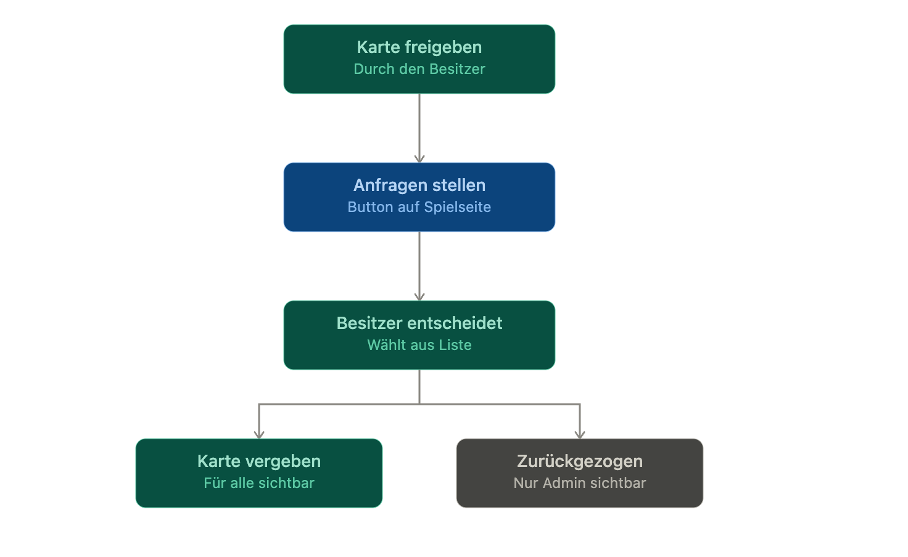
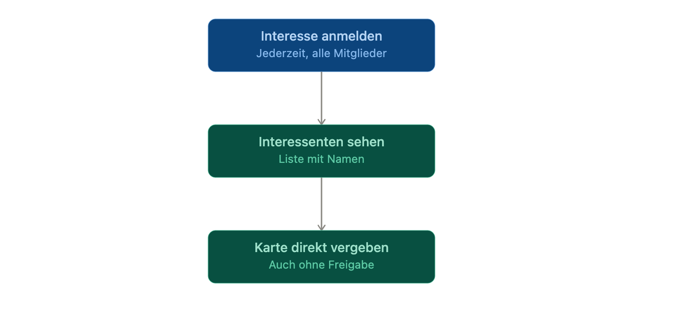
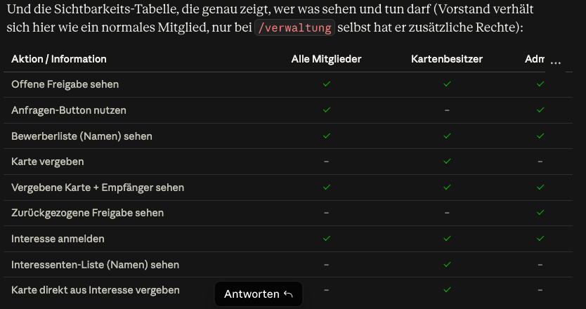

Farblogik in den Grafiken: Türkis = Aktion des Kartenbesitzers, Blau = Aktion eines Mitglieds, Grau = neutraler Endzustand.

Interesse anmelden, ohne dass vorher überhaupt eine Karte freigegeben wurde:

Und die Sichtbarkeits-Tabelle, die genau zeigt, wer was sehen und tun darf (Vorstand verhält sich hier wie ein normales Mitglied, nur bei /verwaltung selbst hat er zusätzliche Rechte):
