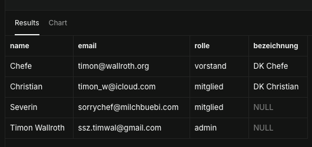

# Test-Accounts

Übersicht der Test-Accounts für manuelle Login-/Rollen-Tests. Passwörter nur für lokale Testumgebung, niemals in Produktion verwenden.

| # | Account-Typ | Name | E-Mail | Passwort | Rolle | Mitglied-Status | Hat Dauerkarte? | Testet |
|---|---|---|---|---|---|---|---|---|
| 1 | Admin | Timon | ssz.timwal@gmail.com | `timon123` | `admin` | `aktiv` | ja | Vollzugriff, "Rollen verwalten" |
| 2 | Vorstand | Chefe | timon@wallroth.org | `chefe123` | `vorstand` | `aktiv` | ja | Verwaltungs-Zugriff ohne Rollenverwaltung |
| 3 | Mitglied mit DK | Christian | timon_w@icloud.com | `christian123` | `mitglied` | `aktiv` | ja | Normale Sicht, Karte-Tab, Freigabe-Mechanismus |
| 4 | Mitglied ohne DK | Severin | sorrychef@milchbuebi.com | `severin123` | `mitglied` | `aktiv` | nein | Zweite Navbar-Variante, Anfragen-Tab |

## Hinweise

- Neu-Registrierung wird bewusst **nicht** vorab geseedet, sondern live über `/registrieren` getestet.
- Passwörter für `@test.local`-Adressen müssen per SQL gesetzt werden (kein Mail-Versand möglich):
```sql
  update auth.users
  set encrypted_password = crypt('Test1234!', gen_salt('bf'))
  where email = '...';
```

